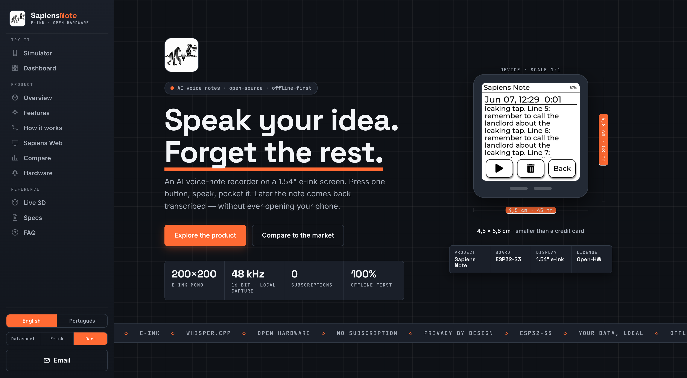
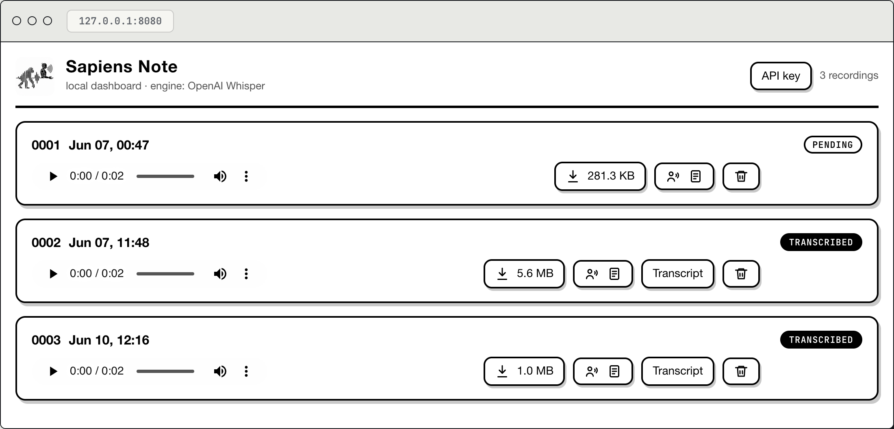
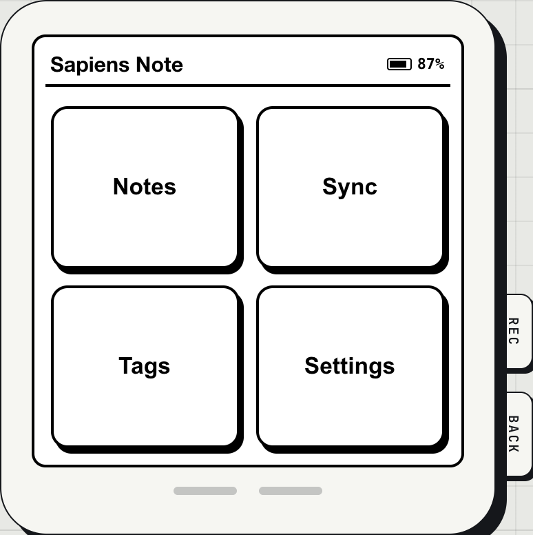

<p align="right"><a href="README.md">🇬🇧 English</a> · <strong>🇧🇷 Português</strong></p>

<p align="center">
  
</p>

<h1 align="center">Sapiens&nbsp;Note&nbsp;— Website</h1>

<p align="center">
  <em>Site de apresentação do <strong>Sapiens Note</strong> — um gravador de notas<br>
  de voz com IA, minimalista e offline-first, numa tela e-ink de 1,54".</em>
</p>

<p align="center">
  
  
  
  
  
  
  
  
</p>

<p align="center">
  <br>
  <sub><b>Datasheet</b> — tema padrão</sub>
</p>

<p align="center">
  <br>
  <sub><b>E-ink</b> — um clique</sub>
</p>

<p align="center">
  <br>
  <sub><b>Escuro</b> — um clique</sub>
</p>

<p align="center"><b>Dois demos reais e funcionais no navegador — sem hardware</b></p>

<p align="center">
  <br>
  <sub><b>Dashboard</b> — grava → transcreve → lê de volta</sub>
</p>

<p align="center">
  <br>
  <sub><b>Simulador do firmware</b> — o aparelho e-ink no navegador</sub>
</p>

---

## ✨ Visão geral

Landing page de produto **estática** — sem build, sem framework. O tema padrão
**"Datasheet"** usa a linguagem da *engenharia de hardware*: grid de papel milimetrado,
linhas de cota (dimensões) e um *title block* em volta do device, designadores de
peça `REF.0x`, labels técnicos em mono e um único acento laranja industrial. São
**três temas de um clique** — **Datasheet** (padrão), **E-ink** (o preto-e-branco
chapado do dispositivo) e **Escuro** — escolhidos num switch de 3 posições na
**barra lateral esquerda**. **Bilíngue** (Inglês / Português) com troca em tempo real,
**responsivo mobile-first**, e **100% offline**: Three.js e as fontes são
vendorizados localmente — **sem CDN**.

A página traz também dois demos **reais e funcionais** no navegador — um simulador do
aparelho e o dashboard Sapiens Web — que compartilham um **IndexedDB** local. Tudo o
que eles fazem fica no navegador; nada é enviado a um servidor (a única exceção é a
transcrição opcional via OpenAI, que usa a sua própria chave).

Conteúdo e specs montados a partir do projeto **Sapiens Note** e da placa real
**Waveshare ESP32-S3-ePaper-1.54** (variante touch).

## 🚀 Destaques

| | Recurso |
|---|---|
| 🧭 | **Barra lateral esquerda** — navegação agrupada (*Experimente · Produto · Referência*) com ícones desenhados, destaque da seção atual (scroll-spy) e um recolhimento elegante para barra superior + drawer no mobile. |
| 🎨 | **Três temas, um switch** — **Datasheet** (cara de engenharia: grid milimetrado, linhas de cota, designadores `REF.0x`, acento laranja), **E-ink** (papel chapado P&B do device) e **Escuro**, num controle de 3 posições. Persistente (`localStorage`); o e-ink também via link (`?eink=1`). |
| 🌐 | **Bilíngue EN / PT-BR** — botões `English` / `Português` na barra lateral; auto-detecta o idioma do navegador e lembra a escolha. |
| 🕹️ | **Simulador do device (real)** — o firmware e-ink no navegador, com ícones desenhados (SVG): **REC grava áudio mono em 48 kHz / 16 bits do microfone** (`MediaRecorder`); a nota fica *pendente* (o aparelho só captura — igual ao firmware) e toca de verdade. Todas as telas (Home · Lista · Gravando · Transcrição · Player · Settings · Sync · Tags · Excluir). (`public/js/simulator.js`) |
| 🖥️ | **Dashboard real (`sapiens-web`)** — porte fiel que lê o **mesmo armazenamento** do aparelho: toca o áudio real com **espectro** ao vivo, **transcreve via OpenAI Whisper** (sua chave, guardada só no navegador), baixa **`.wav`/`.txt`** reais, exclui, pagina. (`public/js/dashboard.js`) |
| 🔁 | **O fluxo real** — grava no aparelho → transcreve no dashboard → a transcrição volta a aparecer no aparelho, via um **IndexedDB** compartilhado (`public/js/store.js`). |
| 🔒 | **Local-first / privado** — gravações, notas e transcrições ficam **só no seu navegador** (IndexedDB); nada é enviado a um servidor. Única exceção: se você usar a transcrição, o áudio vai direto para a OpenAI com a sua chave. |
| 🧠 | **Modelo 3D ao vivo** — o **case real** (Three.js + `GLTFLoader`, GLB convertido do `Assembled.step` do Shapr3D) + internos fiéis (PCB, módulo ESP32-S3, header, USB-C, bateria, tela e-ink), com toggle **Montada ⇄ Explodida** e auto-rotação. |
| 🔩 | **"What's Inside"** — um **desenho técnico em SVG** da placa real, com callouts de engenharia (ESP32-S3, FT6336, ES8311, USB-C, botões BOOT/PWR, bateria Li-ion…) e link para a página do produto **Waveshare ESP32-S3-ePaper-1.54**. |
| 📊 | **Comparação** com players de mercado (Plaud Note, Limitless, Otter.ai, Rabbit R1). |
| 📱 | **Responsivo mobile-first** (até 375 px) e com `prefers-reduced-motion`; **100% offline** — Three.js + fontes locais, zero CDN. |

**Seções:** `Hero` · `Simulador` · `Dashboard` · `Produto` · `Recursos` · `Como funciona`
· `Sapiens Web` · `Comparação` · `What's Inside` · `Live 3D` · `Specs` · `FAQ` · `CTA`

## 🕹️ Simulador do firmware & dashboard

Dois demos **reais** no navegador deixam qualquer um experimentar o produto inteiro sem hardware:

- **Simulador do firmware** (`public/js/simulator.js`) — uma reimplementação em DOM/CSS da
  UI do firmware e-ink: uma **máquina de estados** de telas preto-no-branco (Home · Lista ·
  Gravando · Transcrição · Player · Settings · Sync · Tags · Excluir) com ícones desenhados
  em SVG, o **flash de inversão** e-ink ao toque, marquee nos títulos, paginação e indicador
  de bateria. O **REC** grava de verdade do seu microfone (`MediaRecorder`); a nota é salva
  como *pendente* — o aparelho só captura, igual ao firmware real — e toca de verdade.
- **Dashboard** (`public/js/dashboard.js`) — um porte fiel da ferramenta real `sapiens-web`
  que lê o **mesmo** armazenamento IndexedDB: toca cada gravação com **espectro** de áudio ao
  vivo, transcreve via **OpenAI Whisper** (sua chave, só no navegador), baixa `.wav` / `.txt`
  reais, exclui e pagina.

**O fluxo é o real:** grava no aparelho → transcreve no dashboard → a transcrição volta a
aparecer no aparelho, tudo por um armazenamento compartilhado (`public/js/store.js`). Nada sai
do seu navegador, exceto a transcrição opcional (veja *Onde ficam os seus dados*).

## 🛠️ Stack

- **HTML + CSS + JavaScript** puro (sem bundler).
- **Three.js vendorizado** em `public/assets/vendor/three/` — sem CDN.
- **Google Fonts vendorizadas** em `public/assets/fonts/` — sem CDN.
- i18n caseiro com `data-i18n` + dicionário em `public/js/script.js`.

## 🔒 Onde ficam os seus dados

Tudo o que os dois demos fazem fica **no seu navegador** — não há backend:

- **Gravações + notas + transcrições** → IndexedDB (banco `sapiens-sim`, object stores
  `notes` + `audio`), em `public/js/store.js`.
- **Chave da OpenAI** → `localStorage` (`sn-openai-key`), só no navegador.
- **Único momento em que algo sai do navegador:** a transcrição envia o áudio direto
  para `api.openai.com` com a sua chave. Gravar, ouvir, ler e baixar `.wav`/`.txt` é
  tudo offline. Limpar os dados do site apaga tudo.

## 📁 Estrutura

```
.
├── public/                  ← document root (servido pelo nginx)
│   ├── index.html
│   ├── css/styles.css
│   ├── js/script.js · js/store.js · js/simulator.js · js/dashboard.js
│   └── assets/
│       ├── logo.png · sim-*.png
│       ├── case/assembled.glb   case real (do Assembled.step) + fontes (*.3mf)
│       ├── vendor/three/        Three.js local (core, OrbitControls, GLTFLoader, …)
│       └── fonts/               fontes web locais (woff2 + fonts.css)
├── deploy/                  ← infraestrutura
│   ├── Dockerfile               nginx hardened (unprivileged, alpine)
│   ├── nginx.conf               gzip, cache, fallback SPA (listen 8080)
│   ├── install.sh · uninstall.sh
│   └── DEPLOY.md                guia de deploy (EN · PT-BR)
├── docker-compose.yml       ← serviço 'web' (read-only, não-root)
├── .dockerignore
└── README.md · README.pt-br.md
```

## ▶️ Rodar localmente

Precisa ser servido por **HTTP** (`file://` bloqueia módulos ES e o `fetch` dos `.3mf`):

```bash
cd public
python3 -m http.server 8080
# abra http://localhost:8080
```

## 🐳 Deploy

Para uma VM Ubuntu Server (ex.: Proxmox) — um comando instala o Docker, builda a
imagem **nginx hardened** (não-root, read-only, alpine) e registra um **serviço
systemd** com auto-start no boot:

```bash
git clone https://github.com/gustavoschaedler/sapiens-note-website.git
cd sapiens-note-website
sudo ./deploy/install.sh                            # porta 80
# ou, para acesso só via Cloudflare Tunnel:
sudo SAPIENS_BIND=127.0.0.1 ./deploy/install.sh
```

Guia completo — atualização, **Cloudflare Tunnel**, firewall, hardening:
**[deploy/DEPLOY.pt-br.md](deploy/DEPLOY.pt-br.md)**.

## 🎨 Personalização

- **Temas / cores** — design tokens no topo de `public/css/styles.css`: `:root` (*Datasheet*), `body.dark` (*Escuro*) e `body.eink` (*E-ink*) redefinem o mesmo conjunto de tokens. Tokens-chave: `--bg` (papel milimetrado), `--accent` (laranja industrial), `--ink`, `--muted`, `--line`, `--grid`. O switch de tema de 3 posições (`#themeSw`) e os botões de idioma (`.lang`) ficam na barra lateral; lógica em `public/js/script.js`.
- **Textos / traduções** — objeto `I18N` em `public/js/script.js` (chaves `en` / `pt`).
- **Desenho do What's Inside** — o `<svg class="xray">` inline em `public/index.html` (peças + callouts).
- **Case 3D (Live 3D)** — `public/assets/case/assembled.glb` (convertido do `Assembled.step` via `occt-import-js`); os internos são construídos por código no `<script type="module">` inline.

## 📄 Licença

Veja [LICENSE](LICENSE).
