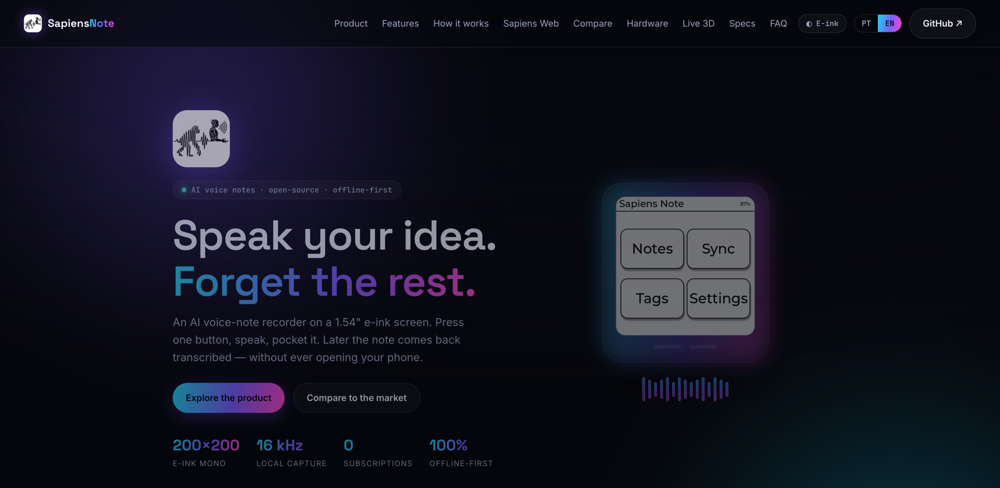
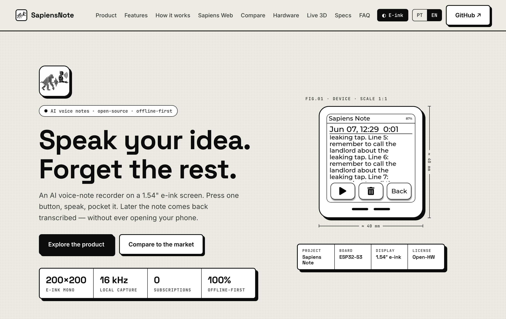

<p align="right"><a href="README.md">🇬🇧 English</a> · <strong>🇧🇷 Português</strong></p>

<p align="center">
  
</p>

<h1 align="center">Sapiens&nbsp;Note&nbsp;— Website</h1>

<p align="center">
  <em>Site de apresentação do <strong>Sapiens Note</strong> — um gravador de notas<br>
  de voz com IA, minimalista e offline-first, numa tela e-ink de 1,54".</em>
</p>

<p align="center">
  
  
  
  
  
  
  
  
</p>

<p align="center">
  
</p>

<table align="center">
  <tr>
    <td align="center"><br><sub><b>Tema neon</b></sub></td>
    <td align="center"><br><sub><b>Modo e-ink</b> (um clique)</sub></td>
  </tr>
</table>

---

## ✨ Visão geral

Landing page de produto **estática** — sem build, sem framework — com visual
futurista e um **modo e-ink** que transforma o site inteiro no preto-e-branco do
dispositivo. **Bilíngue** (Inglês / Português) com troca em tempo real, e
**100% offline**: Three.js e as fontes são vendorizados localmente — **sem CDN**.

Conteúdo e specs montados a partir do projeto **Sapiens Note** e da placa real
**Waveshare ESP32-S3-ePaper-1.54** (variante touch).

## 🚀 Destaques

| | Recurso |
|---|---|
| 🌐 | **Bilíngue EN / PT-BR** — toggle no topo, auto-detecta o idioma do navegador, lembra a escolha. |
| 🌗 | **Modo e-ink** — troca o tema neon escuro pelo visual de papel do device. Persistente + link (`?eink=1`). |
| 🧠 | **Modelo 3D ao vivo** — case interativa (Three.js + `ThreeMFLoader`) a partir dos `.3mf` reais, com toggle **Montada ⇄ Explodida**, auto-rotação e a tela passando os screenshots. |
| 🔩 | **"What's Inside"** — exploded view estilo *flipper.net*, placa detalhada e callouts dos componentes reais (ESP32-S3-PICO-1, ES8311, FT6336, SHTC3, PCF85063, microSD/USB-C, bateria Li…). |
| 📊 | **Comparação** com players de mercado (Plaud Note, Limitless, Otter.ai, Rabbit R1). |
| 🔌 | **100% offline** — Three.js + fontes locais, zero CDN. |
| 📱 | **Responsivo** e com `prefers-reduced-motion`. |

**Seções:** `Hero` · `Produto` · `Recursos` · `Como funciona` · `Sapiens Web`
· `Comparação` · `What's Inside` · `Live 3D` · `Specs` · `FAQ` · `CTA`

## 🛠️ Stack

- **HTML + CSS + JavaScript** puro (sem bundler).
- **Three.js vendorizado** em `public/assets/vendor/three/` — sem CDN.
- **Google Fonts vendorizadas** em `public/assets/fonts/` — sem CDN.
- i18n caseiro com `data-i18n` + dicionário em `public/js/script.js`.

## 📁 Estrutura

```
.
├── public/                  ← document root (servido pelo nginx)
│   ├── index.html
│   ├── css/styles.css
│   ├── js/script.js
│   └── assets/
│       ├── logo.png · sim-*.png · exploded.png
│       ├── case/*.3mf           modelo 3D da case (Live 3D)
│       ├── vendor/three/        Three.js local (core, OrbitControls, 3MFLoader, fflate)
│       └── fonts/               fontes web locais (woff2 + fonts.css)
├── deploy/                  ← infraestrutura
│   ├── Dockerfile               nginx hardened (unprivileged, alpine)
│   ├── nginx.conf               gzip, cache, fallback SPA (listen 8080)
│   ├── install.sh · uninstall.sh
│   └── DEPLOY.md                guia de deploy (EN · PT-BR)
├── docker-compose.yml       ← serviço 'web' (read-only, não-root)
├── .dockerignore
└── README.md · README.pt-br.md
```

## ▶️ Rodar localmente

Precisa ser servido por **HTTP** (`file://` bloqueia módulos ES e o `fetch` dos `.3mf`):

```bash
cd public
python3 -m http.server 8080
# abra http://localhost:8080
```

## 🐳 Deploy

Para uma VM Ubuntu Server (ex.: Proxmox) — um comando instala o Docker, builda a
imagem **nginx hardened** (não-root, read-only, alpine) e registra um **serviço
systemd** com auto-start no boot:

```bash
git clone https://github.com/gustavoschaedler/sapiens-note-website.git
cd sapiens-note-website
sudo ./deploy/install.sh                            # porta 80
# ou, para acesso só via Cloudflare Tunnel:
sudo SAPIENS_BIND=127.0.0.1 ./deploy/install.sh
```

Guia completo — atualização, **Cloudflare Tunnel**, firewall, hardening:
**[deploy/DEPLOY.pt-br.md](deploy/DEPLOY.pt-br.md)**.

## 🎨 Personalização

- **Tema / cores** — variáveis CSS no topo de `public/css/styles.css` (`:root`, `body.eink`).
- **Textos / traduções** — objeto `I18N` em `public/js/script.js` (chaves `en` / `pt`).
- **Imagem do What's Inside / case 3D** — `public/assets/exploded.png` e `public/assets/case/*.3mf`.

## 📄 Licença

Veja [LICENSE](LICENSE).
